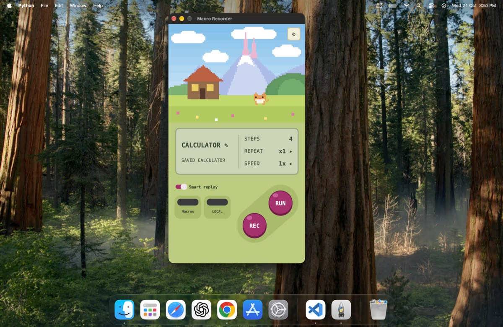
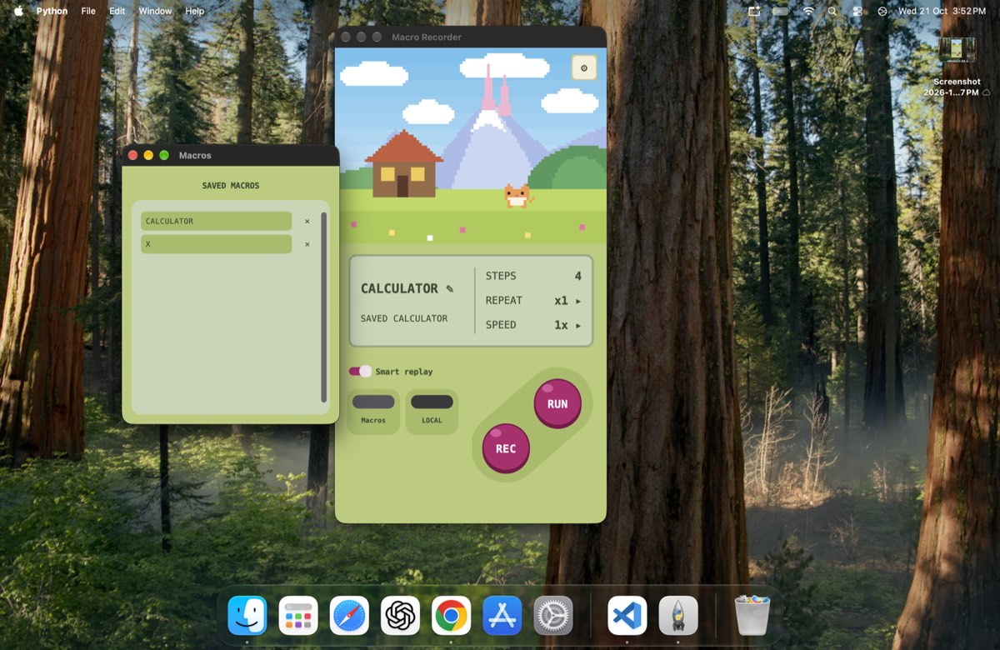

# Macro Recorder

Record your mouse clicks and keystrokes on a Mac, then replay them with one click.
Replay can find each button by looking at the screen, so a macro keeps working even when a window has moved.

<p align="center">
  
  &nbsp;&nbsp;
  
</p>


## Features

- Records clicks (single, double, right), scrolling and keys
- Replays with a repeat count (1 to 100) and speed (0.5x to 3x)
- **Smart replay:** finds each button on screen with image matching. It is free and works offline
- Optional backup when matching fails: a local vision model (Ollama), Claude (needs an API key and internet), or your own model
- **Fast replay:** after a run, answer "Was it right?". Yes saves a faster version of the macro
- Save, open and delete macros
- Optional **Learn from my day:** saves screenshots and click positions on your Mac so you can train your own model later (off by default)

## Install (macOS)

You need macOS and Python 3.12 or newer with Tk. If you see a `_tkinter` error, run `brew install python-tk@3.12`.

```bash
git clone https://github.com/manvendrasingh9299-del/macro-recorder.git
cd macro-recorder
python3 -m venv .venv
source .venv/bin/activate
pip install -r requirements.txt
python run.py
```

### Permissions

Open **System Settings > Privacy & Security** and turn these on for the app you start from (Terminal or VS Code):

- Accessibility (called **Device Control and Data Access** on some versions)
- Input Monitoring
- Screen & System Audio Recording

Then quit that app completely (Cmd+Q) and open it again.

## Use

1. Press **Record**, wait 3 seconds, do your task, then press **F8**.
2. Press **Play** (or **F10**) and keep your hands off the mouse.
3. When it finishes, answer **Was it right?**. Yes makes later runs faster.
4. Tap the macro name to save it. **Macros** opens your saved ones.

Tap **Repeat** and **Speed** to change them. The brain button switches between Local, Claude, Ollama and My model.

| Key | Action |
|---|---|
| F8 | Stop recording |
| F9 | Stop playback |
| F10 | Play |
| F7 | Pause or resume Learn from my day |

On a MacBook, hold **Fn** with these keys unless you turned on standard function keys.

## Brains for Smart replay

| Brain | What it is |
|---|---|
| Local | Default. Image matching on your Mac. Free, offline |
| Ollama | A small local vision model. Run `ollama pull qwen2.5vl:3b`. The app starts the server for you |
| Claude | Needs an API key (Settings). Sends screenshots to Anthropic, so it needs internet |
| My model | Your own model. Put a `find(crop, screen, hint)` function in `my_model.py` |

If a button is not found within 5 seconds, the macro clicks its saved position. Turn on **Stop if target not found** in Settings to stop instead.

## Privacy

- A macro records everything you type, **including passwords**. Do not record passwords.
- Everything stays on your Mac, except when you choose the Claude brain.
- Your data is in `~/Library/Application Support/MacroRecorder/`: `macros/`, `config.json` (settings and API key), `my_model.py`, and `learn/`.

## Project files

| File | Purpose |
|---|---|
| `macro_recorder.py` | The app and its interface |
| `run.py` | Start here. Click sending, button matching, fast replay, Learn from my day |
| `ui_game.py` | Removes clutter from the screen |
| `requirements.txt` | Python packages |

## Limits

- macOS only. Main display only.
- No dragging, and no Cmd or Shift clicks yet.
- Ollama and Learn from my day have had light testing.

## Build the app (experimental)

```bash
pip install pyinstaller
pyinstaller --noconfirm --windowed --name "Macro Recorder" --collect-all customtkinter --collect-all cv2 run.py
```

The app appears in `dist/`. Give `Macro Recorder.app` the three permissions above.