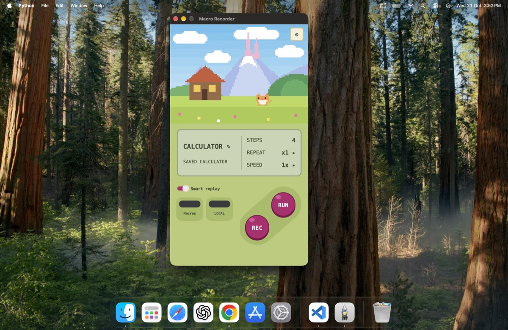
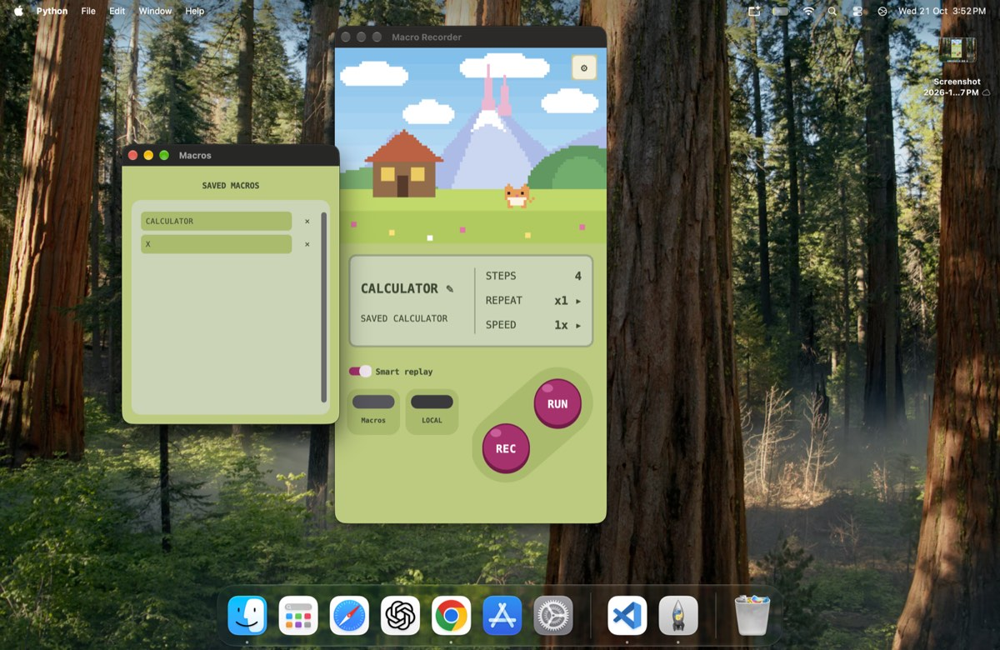

# Macro Recorder

**Record a task once. Replay it any time, even after a window moves.**

Most macro tools click fixed screen positions, so they break the moment a window shifts. Macro Recorder remembers what each button *looks like* and finds it on screen at replay time. It runs on macOS and Windows, and it is **100% local**: no account, no API key, no internet connection, ever.

<p align="center">
  
  &nbsp;&nbsp;&nbsp;
  
</p>
<p align="center"><sub>The main window and your saved macros</sub></p>

## Contents

- [How it works](#how-it-works)
- [Features](#features)
- [Install](#install) ([macOS](#macos) · [Windows](#windows))
- [Usage](#usage)
- [Smart replay options](#smart-replay-options)
- [Privacy](#privacy)
- [Testing on Windows](#testing-on-windows)
- [Troubleshooting](#troubleshooting)
- [Build a standalone app](#build-a-standalone-app-experimental)
- [Project structure](#project-structure)
- [Known limits](#known-limits)

## How it works

1. **Record.** For every click, it saves the click position and a small picture of what you clicked.
2. **Replay.** For every click, it searches the current screen for that picture (image matching with OpenCV) and clicks wherever it finds it.
3. **Fall back.** If image matching fails, your own offline model gets a try (optional). If that fails too, or none is set up, it clicks the saved position.

Everything runs on your computer in the default mode.

## Features

- Records single, double and right clicks, scrolling, and keystrokes
- Repeats 1 to 100 times at 0.5x to 3x speed
- **Smart replay** finds buttons by appearance, so moved windows are fine
- **Fast replay:** after a run, answer "Was it right?". Yes saves a faster version of the macro
- Save, open and delete macros
- Optional: plug in your own offline model as a backup for Smart replay
- Optional: **Learn from my day** saves screenshots and click positions locally so you can train your own model later (off by default)

## Install

You need Python 3.12 or newer.

### macOS

Python must include Tk.

```bash
git clone https://github.com/manvendrasingh9299-del/macro-recorder.git
cd macro-recorder
python3 -m venv .venv
source .venv/bin/activate
pip install -r requirements.txt
python -m macro_recorder
```

**Allow the permissions.** Open **System Settings → Privacy & Security** and turn these on for the app you launch from (Terminal or VS Code):

- **Accessibility** (called *Device Control and Data Access* on some versions)
- **Input Monitoring**
- **Screen & System Audio Recording**

Then quit that app completely (Cmd+Q) and reopen it.

### Windows

**1. Install Python.** Download it from [python.org](https://www.python.org/downloads/), not the Microsoft Store, which can cause path issues. On the first installer screen, tick **Add python.exe to PATH** before clicking Install. This is the step people miss most often. Check it worked:

```powershell
python --version
```

If PowerShell says `python` is not recognized, reinstall and tick that box, or add Python to PATH manually (Windows search → "Edit the system environment variables").

**2. Get the project.** With Git:

```powershell
git clone https://github.com/manvendrasingh9299-del/macro-recorder.git
cd macro-recorder
```

Without Git: click **Code → Download ZIP** on GitHub, unzip it, then Shift + right-click inside the folder and choose "Open PowerShell window here".

**3. Set up and run.**

```powershell
python -m venv .venv
.venv\Scripts\Activate.ps1
pip install -r requirements.txt
python -m macro_recorder
```

If PowerShell says "running scripts is disabled on this system," run this once and activate again:

```powershell
Set-ExecutionPolicy -Scope CurrentUser RemoteSigned
```

No permission dialogs are needed on Windows.

> **Run as administrator? Match both sides.** If the app you are recording or replaying in runs as administrator, Windows silently blocks input from a script that does not. The click just does nothing. Either don't run the target app as administrator, or run your terminal as administrator too. The app checks for this before each replay and tells you if it is the problem.

> **Windows status:** Windows support has been tested with stand-ins for real hardware, but not yet on an actual Windows PC. Run the [self-test](#testing-on-windows) before trusting it with anything important.

## Usage

1. Press **REC**, wait 3 seconds, do your task, then press **F8**.
2. Press **RUN** (or **F10**) and keep your hands off the mouse.
3. When it finishes, answer **Was it right?**. Yes makes later runs faster.
4. Tap the macro name to save it. **Macros** opens your saved ones.

Tap **REPEAT** and **SPEED** on screen to change them. Turn **Smart replay** off to replay exact positions instead.

| Key | Action |
|---|---|
| F7 | Pause or resume Learn from my day |
| F8 | Stop recording |
| F9 | Stop playback |
| F10 | Run the loaded macro |

On a MacBook, hold **Fn** with these keys unless you turned on standard function keys. On Windows, no Fn is needed.

## Smart replay options

Tap the brain button to switch.

| Brain | What it is |
|---|---|
| **Local** | Default. Image matching on your computer. Fully offline, no account needed |
| **My model** | Your own offline model. Put a `find(crop, screen, hint)` function in `my_model.py` |

If a button is not found within 5 seconds, the macro clicks its saved position. Turn on **Stop if target not found** in Settings to stop instead.

## Privacy

- **Fully offline.** No account, no API key, no network calls. Everything stays on your computer.
- **A macro records everything you type, including passwords.** Do not record passwords.
- Your data lives in `~/Library/Application Support/MacroRecorder/` (macOS) or `%APPDATA%\MacroRecorder` (Windows):
  - `macros/` saved macros
  - `config.json` settings
  - `my_model.py` your optional model
  - `learn/` data from Learn from my day, if enabled

## Testing on Windows

If you can run Windows, these scripts help confirm everything actually works — each takes under a minute, and results are welcome as feedback:

| Script | Checks |
|---|---|
| `python scripts\self_test.py` | Screenshots, clicks, double-clicks, right-clicks, and keys all work. Fully automatic, no judgement needed |
| `python scripts\click_test.py` | The same, with a visual yes/no check in Notepad |
| `python scripts\scale_test.py` | Click accuracy isn't thrown off by display scaling (125%, 150%) |
| `python scripts\monitor_test.py` | Only needed if you have two or more monitors |

<details>
<summary><b>Troubleshooting</b></summary>

## Troubleshooting

| You see | Fix |
|---|---|
| `This process is not trusted` (Mac) | Turn on Accessibility and Input Monitoring for your terminal, then quit and reopen it |
| `could not create image from display` (Mac) | Turn on Screen & System Audio Recording, then quit and reopen your terminal |
| `No module named '_tkinter'` (Mac) | Run `brew install python-tk@3.12` and rebuild your `.venv` |
| F8, F9 or F10 do nothing (Mac) | Hold **Fn**, or turn on standard function keys in Keyboard settings |
| The cursor moves but nothing clicks | Mac: recheck the permissions. Windows: make sure the target app isn't running as administrator while your terminal isn't |
| `running scripts is disabled on this system` (Windows) | Run `Set-ExecutionPolicy -Scope CurrentUser RemoteSigned`, then activate again |
| `python` is not recognized (Windows) | Python wasn't added to PATH. Reinstall and tick that box |

## Build a standalone app (experimental)

```bash
./scripts/build_app.sh        # macOS
```

```powershell
.\scripts\build_app.ps1       # Windows
```

The result appears in `dist/`. On macOS, give `Macro Recorder.app` the three permissions above. On Windows, Defender or SmartScreen may warn because the `.exe` is unsigned. That is expected, not a bug.

## Project structure

```
macro-recorder/
├── macro_recorder/
│   ├── __main__.py      Entry point: python -m macro_recorder
│   ├── app.py           The window: recording, replaying, saving
│   ├── interface.py     The screen: pixel scene, green display, buttons
│   ├── matching.py      Finding a button on screen (image matching, optional models)
│   ├── osapi.py         Picks macos.py or windows.py automatically
│   ├── macos.py         macOS only: screenshots, mouse and keyboard control
│   ├── windows.py       Windows only: the same, for Windows
│   ├── learn.py         Optional Learn from my day
│   └── settings.py      Folders, saved settings and macros
├── scripts/
│   ├── build_app.sh     Builds the macOS .app (experimental)
│   ├── build_app.ps1    Builds the Windows .exe (experimental)
│   ├── launch.py        Entry point for both builds
│   ├── self_test.py     Checks screenshots, clicks and keys
│   ├── click_test.py    Checks double-clicks and right-clicks
│   ├── scale_test.py    Checks screen scaling vs. click accuracy
│   └── monitor_test.py  For multi-monitor setups
├── docs/images/         Screenshots used in this README
└── requirements.txt
```

## Known limits

- Built and tested on an Apple Silicon Mac. Windows support is not yet confirmed on a real Windows PC.
- Smart replay only looks at your main display. On other monitors a macro still clicks the right saved spot, but can't re-find a moved button.
- No dragging yet, and no Cmd/Ctrl or Shift clicks.
- Learn from my day has had only light testing.
- Macros recorded with very early versions may click saved positions instead of finding buttons. Record them again.
