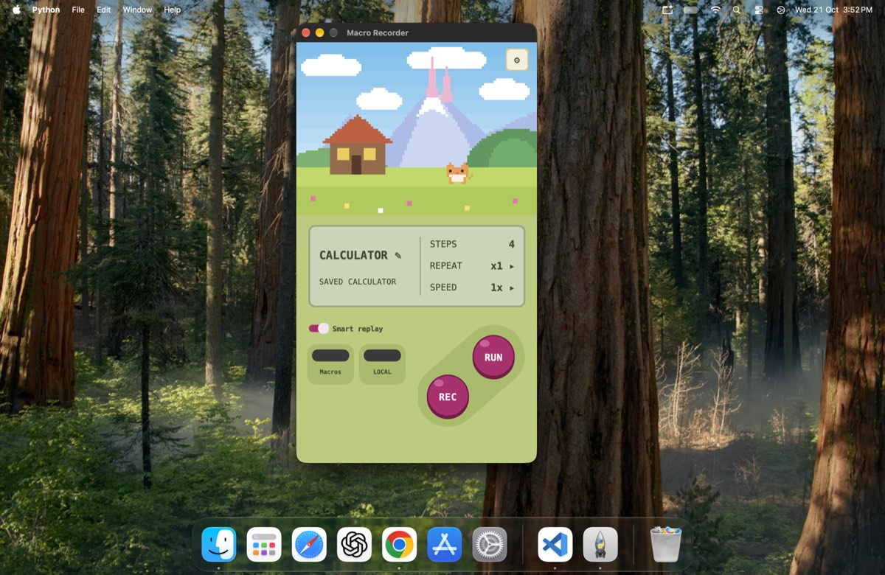
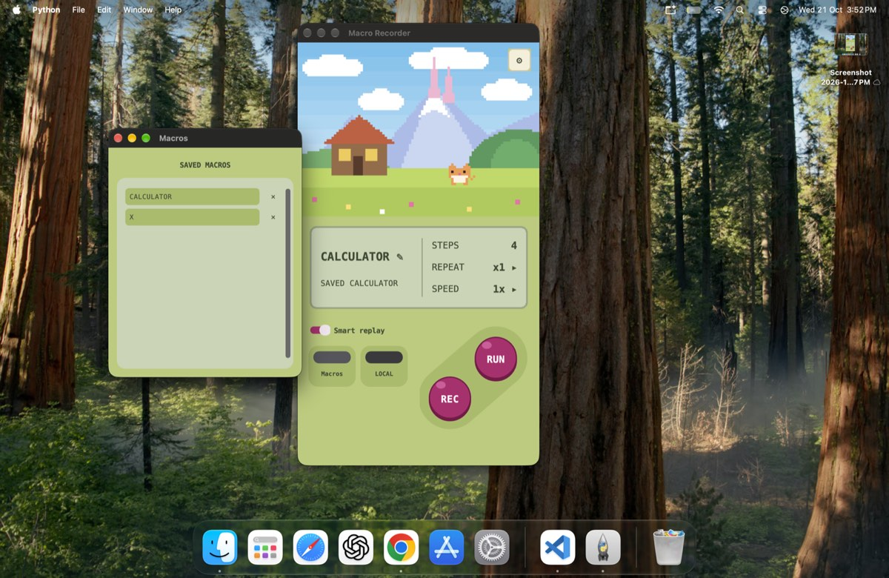

# Macro Recorder

**Record a task once. Replay it any time, even after a window moves.**

Macro Recorder records your mouse clicks and keystrokes and replays them with one click. Most macro tools click fixed screen positions, so they break when a window moves. This one finds each button by looking at the screen. Works on macOS and Windows.

**100% local. No account, no API key, no internet connection needed, ever.**

<p align="center">
  
  &nbsp;&nbsp;&nbsp;
  
</p>
<p align="center"><sub>The main window and your saved macros</sub></p>

## How it works

1. **Record.** For every click, it saves the click position and a small picture of what you clicked.
2. **Replay.** For every click, it looks for that picture on the current screen (image matching with OpenCV) and clicks where it finds it.
3. **Back up.** If matching fails, your own model can try (optional). Otherwise it clicks the saved position.

Everything runs on your computer. No account and no internet are needed for the default mode.

## Features

- Records clicks (single, double, right), scrolling and keys
- Repeat from 1 to 100 times, at 0.5x to 3x speed
- **Smart replay** finds buttons on screen, so moved windows are fine
- **Fast replay.** After a run, answer "Was it right?". Yes saves a faster version of the macro
- Save, open and delete macros
- Optional backup for Smart replay: your own offline model
- Optional **Learn from my day**: saves screenshots and click positions on your computer, so you can train your own model later (off by default)

## Quick start (macOS)

You need macOS and Python 3.12 or newer with Tk.

```bash
git clone https://github.com/manvendrasingh9299-del/macro-recorder.git
cd macro-recorder
python3 -m venv .venv
source .venv/bin/activate
pip install -r requirements.txt
python -m macro_recorder
```

### Allow the permissions

Open **System Settings > Privacy & Security** and turn these on for the app you start from (Terminal or VS Code):

- **Accessibility** (called **Device Control and Data Access** on some versions)
- **Input Monitoring**
- **Screen & System Audio Recording**

Then quit that app completely (Cmd+Q) and open it again.

## Quick start (Windows)

### 1. Install Python

Download Python 3.12 or newer from **python.org** — not the Microsoft Store version, which can cause path issues. On the first install screen, **tick "Add python.exe to PATH"** before clicking Install. This is the step people miss most often.

Confirm it worked:

```powershell
python --version
```

If PowerShell says `python` is not recognized, reinstall and tick that box, or add it manually via Windows search → "Edit the system environment variables".

### 2. Get the project

With Git (check with `git --version`):

```powershell
git clone https://github.com/manvendrasingh9299-del/macro-recorder.git
cd macro-recorder
```

Without Git: click **Code → Download ZIP** on GitHub, unzip it, then open PowerShell inside the folder (Shift + right-click inside it → "Open PowerShell window here").

### 3. Set up and install

```powershell
python -m venv .venv
.venv\Scripts\Activate.ps1
pip install -r requirements.txt
```

If PowerShell blocks the activate script with "running scripts is disabled on this system," run this once, then try again:

```powershell
Set-ExecutionPolicy -Scope CurrentUser RemoteSigned
```

### 4. Run it

```powershell
python -m macro_recorder
```

No permission dialogs are needed on Windows, unlike macOS.

### 5. The one Windows-specific thing to know

If the app you're recording or replaying in is running **as administrator**, Windows silently blocks input sent from a script that isn't also running as administrator — no error, the click just does nothing. Either don't run the target app as administrator, or run your terminal as administrator too, so both sides match. The app also detects this automatically before a replay starts and tells you directly if this is the problem.

### 6. Confirm it actually works

Windows support has been written and tested with stand-ins for real hardware, but not yet run on an actual Windows PC. Before trusting it with anything real, run:

```powershell
python scripts\self_test.py
```

See [Testing on Windows](#testing-on-windows) below for what this checks and the other diagnostic scripts available.

## Use it

1. Press **REC**, wait 3 seconds, do your task, then press **F8**.
2. Press **RUN** (or **F10**) and keep your hands off the mouse.
3. When it finishes, answer **Was it right?**. Yes makes later runs faster.
4. Tap the macro name to save it. **Macros** opens your saved ones.

Tap **REPEAT** and **SPEED** on the screen to change them. Turn **Smart replay** off to replay exact positions instead.

| Key | Action |
|---|---|
| F8 | Stop recording |
| F9 | Stop playback |
| F10 | Run the loaded macro |
| F7 | Pause or resume Learn from my day |

On a MacBook, hold **Fn** with these keys unless you turned on standard function keys. On Windows, the keys work directly with no Fn needed.

## Smart replay options

Tap the brain button to switch.

| Brain | What it is |
|---|---|
| **Local** | Default. Image matching on your computer. Fully offline, no account needed |
| **My model** | Your own offline model. Put a `find(crop, screen, hint)` function in `my_model.py` |

Both options run entirely on your computer. Nothing is ever sent anywhere. If a button is not found within 5 seconds, the macro clicks its saved position. Turn on **Stop if target not found** in Settings to stop instead.

## Privacy

- **Fully offline.** No account, no API key, no network calls. Everything runs and stays on your computer.
- A macro records everything you type, **including passwords**. Do not record passwords.
- Your data is in `~/Library/Application Support/MacroRecorder/` on macOS, or `%APPDATA%\MacroRecorder` on Windows: `macros/`, `config.json` (settings), `my_model.py`, and `learn/`.

## Project structure

```
macro-recorder/
├── macro_recorder/
│   ├── __main__.py     Start here: python -m macro_recorder
│   ├── app.py          The window: recording, replaying, saving
│   ├── interface.py    The screen: pixel scene, green display, buttons
│   ├── matching.py     Finding a button on screen (image matching, optional models)
│   ├── osapi.py        Picks macos.py or windows.py automatically
│   ├── macos.py        macOS only: screenshots, mouse and keyboard control
│   ├── windows.py       Windows only: the same, for Windows
│   ├── learn.py        Optional Learn from my day
│   └── settings.py     Folders, saved settings and macros
├── scripts/
│   ├── build_app.sh     Builds the macOS .app (experimental)
│   ├── build_app.ps1     Builds the Windows .exe (experimental)
│   ├── launch.py        Entry point for both builds
│   ├── self_test.py     One command: checks screenshots, clicks and keys all work
│   ├── click_test.py    Checks double-clicks and right-clicks specifically
│   ├── scale_test.py    Checks screen scaling doesn't throw off click accuracy
│   └── monitor_test.py  For anyone with two or more monitors
├── docs/images/         Screenshots used in this README
└── requirements.txt
```

## Limits

- Built and tested on an Apple Silicon Mac. Windows support has been added and tested with stand-ins for real hardware, but not yet confirmed on an actual Windows PC — see Testing on Windows below.
- Smart replay only looks at your main display, on both macOS and Windows. A macro still clicks the right spot on another monitor, it just can't re-find a moved button there.
- No dragging, and no Cmd/Ctrl or Shift clicks yet.
- Learn from my day has had light testing.
- Macros recorded with very early versions may click saved positions instead of finding buttons. Record them again.


## Add it to your Desktop or Start Menu

### Quickest: a double-clickable launcher

**macOS** — paste this in Terminal once:

```bash
cat > ~/Desktop/"Macro Recorder.command" << 'EOF'
#!/bin/bash
cd ~/Downloads/macro-recorder
source .venv/bin/activate
python -m macro_recorder
EOF
chmod +x ~/Desktop/"Macro Recorder.command"
```

Then double-click **Macro Recorder.command** on your Desktop any time. A Terminal window
briefly appears — that's normal for this approach — then the app opens.

**Windows** — open Notepad, paste this, then save as `Macro Recorder.bat` directly on
your Desktop (choose "All Files" as the file type, not `.txt`):

```bat
@echo off
cd /d "%USERPROFILE%\Downloads\macro-recorder"
call .venv\Scripts\activate.bat
python -m macro_recorder
```

### Nicer: a real app with no console window

Build it with the scripts in `scripts/` (see **Build the app** below), then:

- **macOS**: drag `dist/Macro Recorder.app` into **Applications**, then right-click its
  Dock icon → Options → **Keep in Dock**.
- **Windows**: right-click `dist\Macro Recorder.exe` → **Send to → Desktop (create
  shortcut)**, or drag it onto the Start Menu.
  
<summary><b>Troubleshooting</b></summary>

| You see | Fix |
|---|---|
| `This process is not trusted` (Mac) | Turn on Accessibility and Input Monitoring for your terminal, then quit and reopen it |
| `could not create image from display` (Mac) | Turn on Screen & System Audio Recording, then quit and reopen your terminal |
| The cursor moves but nothing clicks | Check the permissions again (Mac), or check the target app isn't running as administrator while your terminal isn't (Windows) |
| `No module named '_tkinter'` (Mac) | Run `brew install python-tk@3.12` and rebuild your `.venv` |
| `running scripts is disabled on this system` (Windows) | Run `Set-ExecutionPolicy -Scope CurrentUser RemoteSigned`, then activate again |
| `python` is not recognized (Windows) | Python wasn't added to PATH during install — reinstall and tick that box |
| F8, F9 or F10 do nothing (Mac) | Hold **Fn**, or turn on standard function keys in Keyboard settings |

</details>

<details>
<summary><b>Build the app (experimental)</b></summary>

macOS:
```bash
./scripts/build_app.sh
```

Windows:
```powershell
.\scripts\build_app.ps1
```

The app appears in `dist/`. On macOS, give `Macro Recorder.app` the three permissions above. On Windows, Defender/SmartScreen may warn since the file isn't signed — this is expected for an unsigned .exe, not a bug.

</details>
